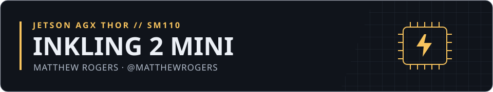

# Inkling 2 Mini on NVIDIA Jetson AGX Thor

By **[Matthew Rogers](https://github.com/RamboRogers)** · [@matthewrogers on X](https://x.com/matthewrogers)

**Native vision is enabled by default**, with up to **16 images per prompt**. On one Jetson AGX Thor, the vision-enabled profile averaged **70.16 output tok/s** on four text tasks with medium reasoning over the LAN. It also passed a **262,144-token context reservation** and separate **four-resident-request** tool workflows, not four simultaneous full-context requests. The earlier text-only loopback run measured **75.44 tok/s** single-user with reasoning off and **104.67 tok/s** aggregate at C4. See [workloads and timing records](benchmarks/README.md).

This repo rebuilds the text-and-vision runtime from pinned public sources. It contains the vLLM patch, Docker launch settings, a checksum-verified model downloader, and the benchmark client. No model weights, private images, or precompiled extensions are required from this repo.

## Quick start

Run on Jetson AGX Thor (`aarch64`, SM110). The measured host used JetPack `7.1-b112` / L4T `38.4.0`, R580 driver `580.00`, CUDA 13.0, MAXN, Docker `28.2.2`, and NVIDIA Container Toolkit `1.18.1`. You need a working Docker BuildKit setup with the `nvidia` runtime, a non-root user with Docker access, Python 3.10+, Git, curl, and enough free SSD space for the large image and ~19 GiB checkpoint. Allow **at least 80 GiB free SSD space** for a fresh build and download, and **64 GiB `MemAvailable`** at the cold-start gate. Start on an idle host; the script will not stop other services, drop OS caches, or change power settings.

```bash
git clone https://github.com/RamboRogers/nvidia-thor-inkling-mini.git
cd nvidia-thor-inkling-mini

python3 build.py
mkdir -p "$HOME/.cache/inkling-thor/models"
python3 fetch_model.py
python3 serve.py start
python3 serve.py smoke --wait 600
```

`build.py` pulls the exact ARM64 vLLM image, fetches pinned CUDA sources, and compiles two SM110a extensions with one worker in a network-disabled, CPU-only container. The final Docker build only copies checked sources, extensions, and notices. The rebuilt image has a different Docker image ID from the original benchmark image; see [provenance and validation](FORMULA.md).

**Upgrading from the text-only launcher?** Use the same v6 image and model snapshot. Stop and remove the container created by the previous quick start, then run the updated `serve.py start` and `serve.py smoke --wait 600`. Restarting an existing container does not apply the new flags.

```bash
# Inspect the full Docker command without starting anything.
python3 serve.py plan

# Use the OpenAI-compatible API after the smoke test passes.
curl --fail-with-body -sS http://127.0.0.1:8010/v1/chat/completions \
  -H 'Content-Type: application/json' \
  -d '{"model":"inkling-mini","messages":[{"role":"user","content":"Explain unified memory in two sentences."}],"reasoning_effort":"medium","max_tokens":2048}'

# Benchmark an idle instance. Use a new output path for each run.
mkdir -p local-results
python3 benchmarks/bench.py --mode fast --label my-thor --out local-results/my-thor.json

# Stop and remove only the container created by the quick start. Caches persist.
docker stop inkling-thor-v6 && docker rm inkling-thor-v6
```

No API key is needed on loopback. The launcher binds to `127.0.0.1`; for another machine, use an SSH tunnel or an authenticated proxy instead of publishing the raw port. If you use `--port` on `serve.py start`, pass the same port to `smoke` and `bench.py`. A cold first start may take several minutes; check `docker logs -f inkling-thor-v6` while it warms up. Docker automatic restart is intentionally disabled.

## Send an image

The quick-start smoke test checks both text and a generated PNG. To try your own PNG, replace `image.png` below. Add one `image_url` content item per image for multi-image prompts.

```bash
python3 - image.png <<'PY' | curl --fail-with-body -sS \
  http://127.0.0.1:8010/v1/chat/completions \
  -H 'Content-Type: application/json' --data-binary @-
import base64, json, sys
from pathlib import Path

png = base64.b64encode(Path(sys.argv[1]).read_bytes()).decode('ascii')
print(json.dumps({
    'model': 'inkling-mini',
    'messages': [{'role': 'user', 'content': [
        {'type': 'image_url', 'image_url': {'url': 'data:image/png;base64,' + png}},
        {'type': 'text', 'text': 'Describe this image in one sentence.'},
    ]}],
    'reasoning_effort': 'low', 'max_tokens': 512,
}))
PY
```

## The formula in one table

| Component | Measured profile |
|---|---|
| Target weights | Thinking Machines Lab Inkling 2 Mini fixed checkpoint, mixed ModelOpt NVFP4/MXFP8 |
| Engine | CUDA 13.0 vLLM `0.1.dev25855+g7cb5dae22` with the [Thor source patch](patches/vllm-thor.patch) |
| Context and scheduling | 262,144 total tokens/request · 4 scheduled sequences · 2,048 batched tokens |
| KV cache | 28 GiB BF16; startup reported 547,353 tokens shared across requests |
| Vision | Native 23-layer `inkling2_vision` encoder; limit of 16 images per prompt |
| Speculation | Bundled probabilistic DSpark, 7 draft tokens, INT8 hot vocabulary, adaptive verify cap |
| Thor tuning | BF16x LM head, global-only FA4 prefill, SM110 split cap, narrowed warmup |

[Exact pins, tuning notes and credits](FORMULA.md) · [Benchmarks and reproduction details](benchmarks/README.md) · [Apache-2.0 license](LICENSE)

Independent community project. Not an official NVIDIA, Thinking Machines Lab, or vLLM release.
